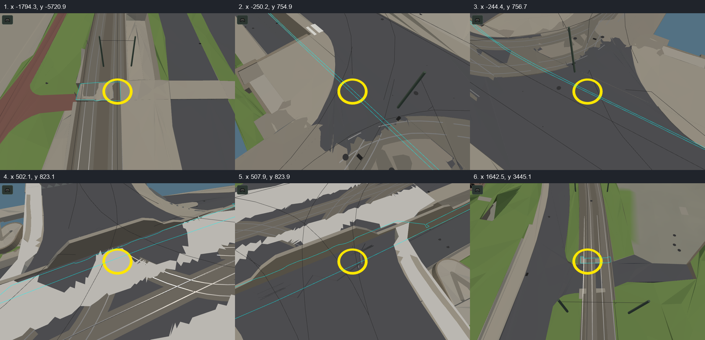

# Held pedestrian patches (#146)

Eight held survey patches occupy six places on line 17. Open the game with
`?line=17&review=reports/review/pedestrian-crossings.json` to answer each place. The live review has
imagery links, notes and four choices: crossing at rail level, sidewalk/platform edge, another level,
or unsure. The patches retain their source heights until reviewed evidence resolves them.

Cyan outlines show the surveyed patches; yellow rings mark the review locations. Pictures use the
pinned 2026-11-01 data. The two duplicate-layer pairs share one question per place.



| Picture | Place | City x, y (m) | Imagery |
|---|---|---|---|
| 1 | Pobřežní cesta | -1794.3, -5720.9 | [Mapy aerial](https://mapy.com/fnc/v1/showmap?mapset=aerial&center=14.407400,50.034213&zoom=19&marker=true), [Street View](https://www.google.com/maps/@?api=1&map_action=pano&viewpoint=50.034213,14.407400&heading=0) |
| 2 | Čechův most | -250.2, 754.9 | [Mapy aerial](https://mapy.com/fnc/v1/showmap?mapset=aerial&center=14.416423,50.093788&zoom=19&marker=true), [Street View](https://www.google.com/maps/@?api=1&map_action=pano&viewpoint=50.093788,14.416423&heading=333) |
| 3 | Čechův most | -244.4, 756.7 | [Mapy aerial](https://mapy.com/fnc/v1/showmap?mapset=aerial&center=14.416500,50.093811&zoom=19&marker=true), [Street View](https://www.google.com/maps/@?api=1&map_action=pano&viewpoint=50.093811,14.416500&heading=295) |
| 4 | Čechův most | 502.1, 823.1 | [Mapy aerial](https://mapy.com/fnc/v1/showmap?mapset=aerial&center=14.426710,50.095317&zoom=19&marker=true), [Street View](https://www.google.com/maps/@?api=1&map_action=pano&viewpoint=50.095317,14.426710&heading=133) |
| 5 | Strossmayerovo náměstí | 507.9, 823.9 | [Mapy aerial](https://mapy.com/fnc/v1/showmap?mapset=aerial&center=14.426789,50.095332&zoom=19&marker=true), [Street View](https://www.google.com/maps/@?api=1&map_action=pano&viewpoint=50.095332,14.426789&heading=197) |
| 6 | Nad Trojou | 1642.5, 3445.1 | [Mapy aerial](https://mapy.com/fnc/v1/showmap?mapset=aerial&center=14.437513,50.120069&zoom=19&marker=true), [Street View](https://www.google.com/maps/@?api=1&map_action=pano&viewpoint=50.120069,14.437513&heading=20) |

Regenerate the queue from a fresh crossing check:

```sh
python -I tools/crossing_review.py reports/headless/line17-crossing.json
```

Queue identities use place rather than generated array indexes. Candidate indexes are diagnostic
references for the captured build. A reviewed answer becomes a fact keyed by place or a stable source
record and cites its saved review; the queue itself supplies no height approval. The overlapping slab
sides near picture 1 are recorded in [#166](https://github.com/jnd-cz/prague-transport-sim/issues/166#issuecomment-6575343814).
